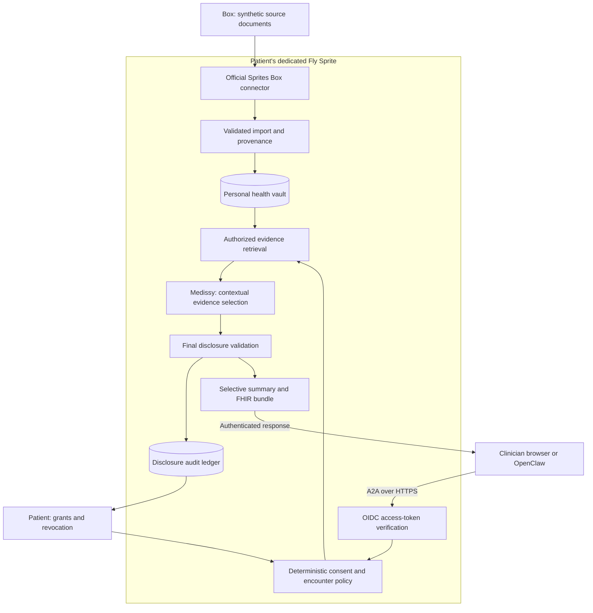

# medissy

**Your personal medical data embassy.**

One health identity. A lifetime of records. Shared with the right people, for the right reasons.

[The idea](#the-idea) · [How it works](#how-it-works) · [Architecture](#architecture) · [The demo](#the-demo) · [Build specification](docs/IMPLEMENTATION.md)

> **Your doctor shouldn't have to know where your medical records live. They should only need to know who you are.**

> [!IMPORTANT]
> Medissy is a proposed Hacksgiving 2026 proof of concept. The implementation is not yet complete. All demo patients, records, clinicians and institutions are fictional. This is not a clinical product, a source of medical advice, an emergency service, or a claim of healthcare regulatory compliance.

## The idea

We have one body, but our medical histories live in many places. Hospitals have their records. Clinics have theirs. Our phones and wearables collect another part of the story. When we see a new doctor, we become the messenger, trying to remember medications, explain previous diagnoses and locate documents we may not even know exist.

Medissy imagines a different relationship with healthcare information: a personal agent that represents the patient, not the institution.

It brings authorized copies of records into a personal health vault, preserves where they came from, and gives the patient a stable health address. A verified clinician or their AI agent can request evidence for a particular encounter. Medissy checks the clinician's authority, retrieves information within the patient's approved scope, prepares a source-linked response and records the disclosure.

The agent does not diagnose, recommend treatment, decide that withheld records are clinically irrelevant, or replace the original medical record. Clinicians can request additional information, subject to the patient's authorization.

**A patient has one address to share. Their medical history remains under governed access.**

## How it works

1. **Connect.** A patient imports authorized copies of medical records. In the prototype, a dedicated Box account contains synthetic medical documents and FHIR data; the official Fly Sprites Box connector retrieves them without embedding a Box credential in the Sprite.
2. **Authorize.** The patient grants verified clinicians or care organizations access for a specific purpose, scope, encounter and time period.
3. **Request.** A clinician signs in using an approved OIDC identity provider and describes the encounter through a browser or their own agent, such as OpenClaw. The clinical agent invokes Medissy over A2A with an appropriately scoped OAuth access token.
4. **Respond.** A deterministic authorization layer filters the eligible evidence before an LLM can see it. The LLM helps interpret the question and rank records. The server validates the final output and returns authorized source-linked records, a selective summary and a machine-readable FHIR bundle.
5. **Account.** The patient receives an audit receipt showing who requested what, for which purpose, under which authorization, and which records were actually released. Access can be revoked for future requests.

### One patient, different clinical encounters

| Requester | Purpose | Example result |
| --- | --- | --- |
| Verified cardiology clinician | Cardiovascular follow-up | Approved baseline summary, ECG report and blood pressure observations |
| Verified dental clinician | Dental extraction assessment | Approved baseline summary and relevant medication and bleeding history |
| Verified but unauthorized clinician | Requests the complete history | No disclosure; request authorization if appropriate |
| Unauthenticated caller | Any request | No disclosure |

These are synthetic examples, not rules determining what a real doctor needs. Each response is explicitly a selective extract with coverage and source timestamps, not a complete medical history. The clinician can ask for an expanded scope. Restricted data must not be disclosed through hints, counts, titles or summaries.

## Architecture

### One address, two interfaces

The envisioned patient address is an opaque, stable HTTPS URL, for example `https://p7k2.medissy.example` (illustrative only). It can be shared as a QR code or a link. The URL identifies where to contact the agent, not who is entitled to access records.

- **For people:** a minimal clinician portal, with OIDC sign-in, clinical question form, evidence cards and a scoped-access request workflow.
- **For agents:** an A2A Agent Card at `/.well-known/agent-card.json` and an authenticated A2A JSON-RPC endpoint.
- **For clinical systems:** authorized FHIR R4 artifacts; a full FHIR server and live EHR integrations are future work.

Public discovery contains no patient identity or health data. Records and task artifacts always require authorization.

### OpenClaw as the clinical interface

An authorized clinician can ask their OpenClaw agent a question about the patient, using a Medissy adapter that obtains a clinician-bound, audience-restricted OAuth access token. The adapter invokes A2A and presents the returned evidence as a rich, interactive chat widget using OpenClaw's supported `show_widget` capability. Unsupported clients receive text and a link to the authenticated portal.

A2A handles agent communication. OAuth/OIDC provides identity and authorization plumbing. Medissy enforces patient consent. OpenClaw renders the result; it does not grant access.

The bundled OpenClaw A2A channel currently documents static peer bearer tokens. Dynamic clinician identity propagation is an explicit adapter requirement, not an assumed built-in feature.

### Why a Sprite?

A personal health envoy must exist independently of a chat session, a phone or a particular AI provider. A dedicated Sprite provides a persistent Linux environment, an HTTPS service address, durable state and on-demand wake-up.

The agent can sleep when nobody needs it, wake when an authenticated service request arrives, and return to idle after work completes. The patient does not need to be online for a previously approved request. Cold-start latency and availability must be measured, not assumed suitable for emergency care.

A skill can help an assistant read a document. Medissy is an independently addressable service with a persistent patient-specific identity, records, policy and audit history. Existing assistants become its clients rather than its competitors.

## The demo

**One patient. Two doctors. Two different authorized views.**

| Scene | What happens |
| --- | --- |
| 1. A fragmented history | Synthetic records from several providers are imported through the official Box connector. |
| 2. Share one address | The patient displays an opaque URL or QR code; the Sprite is idle. |
| 3. Doctor A | A clinician authenticates, requests evidence for a cardiac follow-up, and receives a purpose-scoped view in OpenClaw. |
| 4. Doctor B | A separately authenticated dental clinician asks another question and receives a different authorized view. |
| 5. The boundary | An untrusted caller or a request for restricted records is denied, even with a prompt-injection attempt. |
| 6. Ask for more | The clinician requests an expanded scope; the patient approves a narrowly scoped, expiring grant. |
| 7. Accountability | The patient sees exactly what was disclosed and under which policy. Revocation blocks future access. |

No real patient information or production hospital integrations are required. The build should demonstrate actual Box reads, real test-issuer token validation, real A2A calls, and policy enforcement, not a scripted UI pretending to be a live system.

## Security and clinical boundaries

- Deny by default. A trusted identity is not proof of an active treatment relationship.
- Bind access to a verified subject, issuer, audience, organization, encounter, purpose, scope and expiration. Never accept clinician claims supplied in a prompt as identity evidence.
- Keep the LLM behind an authorization boundary; treat imported content and remote requests as untrusted. Never give a general-purpose agent shell access to the vault.
- Return original source evidence with provenance, dates and limitations. Preserve conflicts and distinguish patient-entered data from provider-originated data.
- Recheck authorization when returning an artifact or expanding a request, including after revocation. Prevent cross-request and cross-user leakage.
- No autonomous emergency override. A production emergency workflow requires separate clinical, legal and operational governance, and a reliable non-AI fallback.
- No real health records until independent security, privacy and clinical safety reviews and the applicable legal and regulatory arrangements are in place.

## Build status and roadmap

This repository is initially the project vision and engineering specification. The [implementation brief](docs/IMPLEMENTATION.md) is the source of truth for the planned MVP, deployment, fixtures, acceptance tests and demo.

The first milestone is a working single-patient synthetic-data deployment. Later possibilities include authorized record synchronization, patient-approved portable summaries, bidirectional provider exchange and standards-based hospital onboarding. None are implied to be available today.

## Built on open standards

- [Fly.io Hacksgiving](https://fly.io/hacksgiving/) and [Sprites](https://docs.sprites.dev/working-with-sprites/)
- [Official Sprites connectors, including Box](https://fly.io/sprites/ecosystem/)
- [A2A protocol specification](https://a2a-protocol.org/v1.0.1/specification/)
- [OpenClaw A2A channel](https://docs.openclaw.ai/channels/a2a) and [rich chat output](https://docs.openclaw.ai/web/control-ui/chat)
- [OpenID Connect Core](https://openid.net/specs/openid-connect-core-1_0.html) and [OAuth JWT access token profile](https://www.rfc-editor.org/rfc/rfc9068)
- [FHIR R4](https://hl7.org/fhir/R4/) and [International Patient Summary](https://www.hl7.org/fhir/uv/ips/en/index.html)

---

**Healthcare has always had institutions that represent themselves.**

**What if every patient had one that represented them?**

