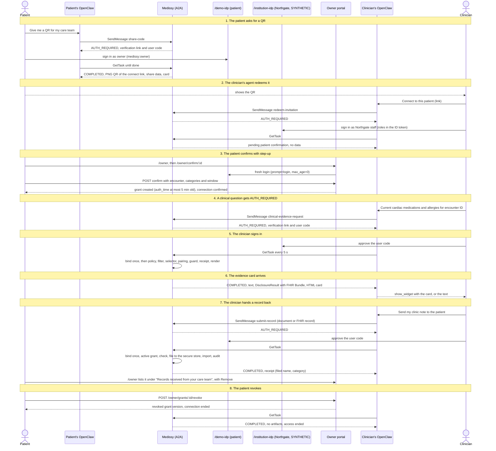

# User journey

These are the eight steps from "share my records" to "access ended", including a record the clinician hands back. The patient and the clinician each use their own OpenClaw agent with the generic `a2a-client` skill, plus a browser for sign-in. Every arrow to Medissy is A2A 1.0 (`SendMessage` and `GetTask`) or a browser request.

Evidence: each step is covered locally by [tested] `spec/a2a/e2e.spec.ts` and `spec/skills/a2a-client.spec.ts`, with step 3 in `spec/portal/step-up.spec.ts`, step 7 in `spec/a2a/e2e.spec.ts` "should file a record for a signed-in clinician with an active grant through the stub gateway" and `spec/portal/inbound.spec.ts`, and step 8 in `spec/sharing/a07.spec.ts`. The scripted run (`pnpm journey`) passed the earlier seven steps against the Sprite [observed 2026-11-26, Box-synced records] before doctors moved to `/institution-idp` (ADR-9). With both features merged, all eight steps pass locally with `MEDISSY_INBOUND_STORE=fixture` [observed 2026-11-26, merged build]. Against the redeployed Sprite all eight pass [observed 2026-11-26, 14.2 s], with step 5 approved at `/institution-idp` and step 7 filing into the real Box folder. The same journey in OpenClaw desktop against the Sprite is **NOT RUN** (A12).

Two synthetic issuers take part. The patient owner signs in at `/demo-idp`. Doctors sign in at `/institution-idp`, "Northgate Health (SYNTHETIC)", whose ID token names their role; Medissy takes their organisation from its own issuer config (ADR-9).

## Sequence

## Steps

| # | Owner side | Clinician side | Result |
| --- | --- | --- | --- |
| 1 | Asks the patient agent for a QR, then signs in at `/demo-idp` as the owner | — | A single-use invitation that lasts 24 h. Only its hash is stored (ADR-7). |
| 2 | — | Gives the link to their agent, then signs in at `/institution-idp` | A **pending** connection. Nothing is shared. Medissy records the doctor's Northgate role and organisation at this sign-in (ADR-9). |
| 3 | Opens the confirm page, re-enters the passphrase, and picks the encounter (existing or new), categories and window | — | Only this POST creates a grant. A pending connection lapses after 7 days. |
| 4 | — | Asks a question with the encounter ID. [inferred] The clinician sees the encounter ID on the `/clinician` page after sign-in. | `AUTH_REQUIRED` with a sign-in link and user code. No token reaches the agent. |
| 5 | — | Approves the user code at `/institution-idp` | The task binds to this clinician once (ADR-4), with the roles from this sign-in's ID token. |
| 6 | — | Sees the card, or the text with its portal link | Selective evidence, a receipt, and FHIR R4 data. |
| 7 | Sees the receipt on `/owner`; may Remove it | Asks their agent to send a note or result, then approves the user code | Filed into the secure store and shareable at once. Without an active grant: the same denial a clinical request gets, and nothing is filed. Remove marks it entered-in-error, never released again (ADR-10). |
| 8 | Revokes on `/owner` | The next poll shows "access ended" | No artifacts and no downloads. Data already released is not retracted. |

## Exact views (brief §10)

| Surface | Shows | Never shows |
| --- | --- | --- |
| Patient agent, step 1 | Sign-in link and user code, then the PNG QR (shown via a `MEDIA:` line), the share data and a card | The raw token after that one response; later polls omit it ([tested] `spec/a2a/e2e.spec.ts` "should give the signed-in patient owner a single-use QR over A2A that a clinician then redeems, pending patient confirmation") |
| Clinician agent, steps 2 and 4 | Sign-in link and user code (`verificationUri`, `userCode`, `expiresAt`), then "SYNTHETIC DEMO: pending patient confirmation …" | Any token, device code, patient data or counts |
| Clinician agent, step 6 | Text: selective extract notice, evidence with sources, conflicts, "Portal (sign-in required)" link, download links for in-scope files. Data: `DisclosureResult` + FHIR `collection` Bundle. Card: the same, escaped | Restricted records, their titles or counts, model prose |
| Clinician agent, step 7 | Sign-in link and user code, then "filed" text and the receipt data part (`submissionId`, `recordId`, `resourceType`, `category`, `filedName`, `filedAt`) | The Box file id, any other patient data |
| Clinician agent, denial | Text and the denial data part only | Why, beyond a generic reason; any record metadata |
| `/clinician` portal | Released evidence per request (request ID, encounter, categories, access until); a scope-request form once the connection is confirmed and an encounter admits them [observed in `src/portal/clinician.ts`] | Anything outside current grants |
| `/owner` dashboard | Pending scope requests; grants (effect, grantee, encounter, version) with revoke; receipts (time, requester, encounter, decision and rationale, released record IDs); records received from the care team (clinician name and organisation, time, filed name, Box file id, category, status) with Remove [observed in `src/portal/owner-pages.ts`] | — (the owner sees the full ledger) |
| `/owner/confirm/:id` | The requester as stated (inert text), the encounters that admit them, or a new encounter length, and categories and window | — |

Every page and card is labelled SYNTHETIC DEMO ([tested] `spec/portal/owner.spec.ts` "should render stated names inert and label every page SYNTHETIC DEMO").
