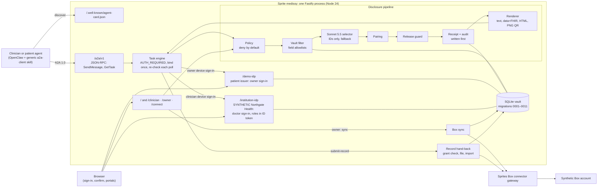

# Medissy architecture

Medissy is one patient's own AI agent. It runs on the Fly Sprite `medissy` as **one Node 24 Fastify process**. Other agents reach it only over **A2A 1.0 JSON-RPC**, and people reach it through server-rendered pages. Inside, a disclosure **pipeline** of deterministic gates wraps one bounded model call. All data is synthetic.

Evidence labels: **[tested]** names the spec that covers the claim; **[observed]** says what was seen and where; **NOT RUN** means it has not been checked live. Deployed behaviour is NOT RUN until DEP01 ([STATUS.md](../STATUS.md)).

## System diagram



## Routes

| Route | Who | Purpose |
| --- | --- | --- |
| `GET /.well-known/agent-card.json` | Anyone | A generic card with no patient data. It advertises no issuer, so it does not reveal which hospital the patient uses; sign-in is described in-task (ADR-4, ADR-9). |
| `POST /a2a/v1` | Any A2A 1.0 client | `SendMessage` and `GetTask` only. Needs `A2A-Version: 1.0`. Streaming, `ListTasks` and the extended card are refused. |
| `GET /a2a/v1/tasks/:taskId/files/:fileId` | Task holder | Gated source download, registered only when a file reader is configured (ADR-2). |
| `/demo-idp/*` | Patient owner's browser | The patient's demo-only OIDC issuer: owner device approval, portal login and step-up (ADR-3). |
| `/institution-idp/*` | Clinician's browser | SYNTHETIC Northgate Health, the one trusted institution: doctor device approval and portal login; the ID token names the roles (ADR-9). |
| `GET /` and `/clinician`, `POST /clinician/scope-requests` | Clinician | Landing page, released evidence, expanded-scope request. |
| `GET /portal` | Patient owner | Post-login redirect: back to a pending step-up confirm page, otherwise `/owner`. |
| `/owner`, `/owner/confirm/:id`, `/owner/grants/:id/revoke`, `/owner/invitations`, `/owner/sync`, `/owner/inbound/:id/remove` | Patient owner | Dashboard, step-up confirm and decline, revoke, share code, Box sync (ADR-7), and Remove for a record the care team handed back (ADR-10). |
| `GET`/`POST /connect` | Clinician browser | Invitation redemption in a browser. |
| `/auth/:kind/sign-in`, `/auth/callback` | Browser | Authorization code + PKCE for the owner (at `/demo-idp`) and clinician (at `/institution-idp`) portal sessions; the kind picks the issuer, never a parameter. |
| `GET /healthz` | Platform | `{status, synthetic}` only. |

## Module map

```text
src
├── server.ts       # createApp/createFromEnv: one vault, host guard, proxy trust, feature setups
├── contracts       # Zod schemas: principal, grant, record, disclosure, receipt, task, sharing, sign-in
├── demo-idp        # issuer factory (/demo-idp, /institution-idp), personas, passphrases, lockout, keys, trust seed
├── identity        # IssuerConnection, at+jwt verifier, institution sign-in (ID token roles), JIT registry, device flow, sessions, CSRF, rate limits
├── a2a             # Agent Card, JSON-RPC handler, task engine and store, downloads
├── policy          # deny-by-default decision over grants, encounters and field allowlists
├── vault           # migrator, record store, pre-model filter, source catalogue
├── disclosure      # selector, pairing, guard, receipt ledger, FHIR bundle, result
├── widgets         # text, data, escaped HTML card, PNG + SVG QR
├── sharing         # invitations, connections, scope requests, grant decisions and revoke
├── portal          # clinician and owner pages, step-up confirm, Box sync trigger
├── inbound         # record hand-back (ADR-10): grant check, record build, filing, receipts, Remove
└── box             # connector gateway client and upload store, fixture adapter and store, parse, curate, ingest, sync
skills/a2a-client   # generic A2A 1.0 client skill for OpenClaw (no Medissy logic)
profiles            # patient, cardiology and dental OpenClaw profiles
migrations          # 0001–0011 SQL
```

## Disclosure pipeline

`src/disclosure/pipeline.ts`: policy → filter → selector → pairing → guard → receipt transaction → result. Any error, guard violation or audit failure releases nothing and returns a fixed denial. Logs carry stage, codes, counts and latency only.

| Step | Module | Guarantee | Evidence |
| --- | --- | --- | --- |
| Policy | `src/policy` | Deny by default. The encounter comes from the DB; a guessed encounter gets the same deny as an unknown one. | [tested] `spec/policy/decide.spec.ts` "should give a guessed encounter the same deny as an unknown one (A05)" |
| Filter | `src/vault/filter.ts` | Runs before any model call. Keeps allowlisted nested fields only. | [tested] `spec/vault/filter.spec.ts` "should keep every allowlisted nested field and drop meta, narrative, identifiers and display-only references" |
| Selector | `src/disclosure/selector.ts` | Picks IDs from the allowed set, or falls back to the baseline (ADR-5). | [tested] `spec/disclosure/selector.spec.ts` |
| Pairing | `src/disclosure/pairing.ts` | Adds the allowed partner of a selected record, such as both sides of a conflict. | [tested] `spec/disclosure/hardening.spec.ts` "should still add the allowed partner of a model-selected record" |
| Guard | `src/disclosure/guard.ts` | Rebuilds output from authorized projections. Fails closed on foreign or repeated IDs and drops references outside the release. | [tested] `spec/disclosure/guard.spec.ts` |
| Receipt | `src/disclosure/receipt.ts`, `ledger.ts` | Re-checks the latest grant version, then writes the receipt and audit before release. | [tested] `spec/disclosure/receipt.spec.ts`; `spec/disclosure/pipeline.spec.ts` "should release nothing when the audit write fails, and log only content-free facts" |
| Render | `src/widgets` | Text, DisclosureResult + FHIR R4 collection Bundle, escaped HTML (ADR-6). | [tested] `spec/widgets/parts.spec.ts` |

## Data model

| Migration | Tables | Key invariants (triggers and checks) |
| --- | --- | --- |
| 0001 identity | `patient`, `trusted_issuers`, `clinicians`, `encounters` | An encounter's policy inputs are fixed. Its window and lifecycle are checked. |
| 0002 sharing | `invitations`, `connections`, `scope_requests` | Single use and terminal states are final. One live connection per requester. No deletes. |
| 0003 grants | `grants` | Append-only versions (`grants_version_is_next`, `grants_no_update`). Revocation is final. |
| 0004 records | `sync_runs`, `record_sources`, `records`, `record_conflicts` | Records change status only. Conflicts resolve forward only. |
| 0005 a2a_idp | `a2a_tasks`, `idp_store` | A task binds once, only from AUTH_REQUIRED. Terminal tasks are frozen. Expiry never extends. |
| 0006 audit_receipts | `audit_events`, `receipts`, `receipt_records` | Append-only. A receipt record needs a live grant. |
| 0007 pending_signins | `pending_signins` | One pending sign-in per task. Identity is fixed, and terminal is final. |
| 0008 receipt_request_digest | `receipts.request_digest` (column) | A reused request ID with a different question is refused (enforced in `src/disclosure`, tested in `spec/disclosure/hardening.spec.ts`). |
| 0009 institution_issuers | `trusted_issuers.kind`, `organization_id`, `organization_name`, `role_claim`, `allowed_roles` (columns) | An institution must configure its organisation, role claim and allowed roles; a patient issuer configures none. At most one institution is enabled. Legacy registry rows lose their roles. `clinicians` becomes a just-in-time record of verified institution sign-ins, superseding the 0001 comment (ADR-9). |
| 0010 inbound_records | `inbound_submissions`; `audit_events` rebuilt with `record.submitted` and `record.removed` | One receipt per record and per source. Only the first removal may update a receipt; no deletes or replaces. The audit table keeps its append-only triggers. |
| 0011 unsigned_requests | `unsigned_requests` (patient, UTC day, skill, count) | Requests that stopped at sign-in, counted when their unbound task is purged. Content-free: no caller address, message or task ID; one row per day and skill. |

## Decisions

| ADR | Decision |
| --- | --- |
| [ADR-1](adr/ADR-1.md) | One Sprite, one Node 24 Fastify process, in-process vault |
| [ADR-2](adr/ADR-2.md) | Box through the Sprites connector gateway, with one redirect allowed, to `boxcloud.com` |
| [ADR-3](adr/ADR-3.md) | `/demo-idp` is a demo-only in-process issuer (departure I-3); partially superseded by ADR-9 |
| [ADR-4](adr/ADR-4.md) | In-task AUTH_REQUIRED device sign-in; the task ID is the only poll secret (D10) |
| [ADR-5](adr/ADR-5.md) | The Sonnet 5.5 selector picks IDs only, with a deterministic fallback |
| [ADR-6](adr/ADR-6.md) | Text, data, escaped HTML and a PNG QR, read by a generic A2A client skill (departure I-2) |
| [ADR-7](adr/ADR-7.md) | Single-use QR invitation; only the step-up confirm page creates grants |
| [ADR-8](adr/ADR-8.md) | Explicit `node:sqlite` migrations with trigger invariants |
| [ADR-9](adr/ADR-9.md) | Doctor identity and role come from a trusted institution's ID token |
| [ADR-10](adr/ADR-10.md) | A clinician hands a record back over A2A under an active grant; it is filed at once and the patient can remove it |

Related: [JOURNEY](../JOURNEY.md) · [SECURITY](../SECURITY.md) · [INTEGRATION](../INTEGRATION.md) · [DEMO](../DEMO.md) · [STATUS](../STATUS.md)
